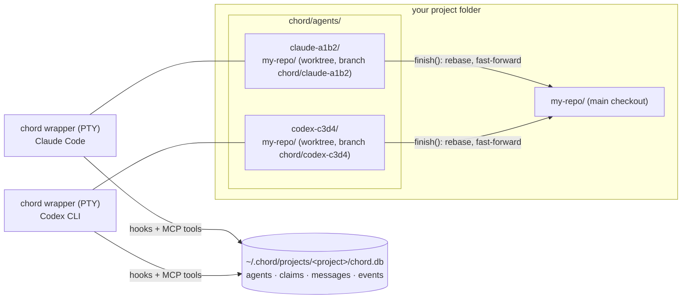

# chord

Run several coding agents on one git project at the same time, without them treading on each other.

chord launches Claude Code and Codex CLI sessions, gives each its own git worktree, and sits between them with a shared record of who is editing which file and a message channel. An agent that wants to change a file somebody else holds has to say so and hear back first. When an agent is done, one call rebases its branch and fast-forwards main. Idle agents are woken when a message arrives, so a conversation between two agents does not wait for a human to prod either of them.

Agents learn all of this from chord itself at start-up and on every prompt. You give tasks in your own words, nothing more.



## Status

Early. Tested only on Windows 11, with Claude Code 2.1.x and Codex CLI 0.163. It has been run on real repositories (Python, Rust, JavaScript) with four to twenty agents, but expect rough edges, and read "What chord does to your machine" before trying it on a repository you care about.

## Requirements

- Windows 11 (other platforms untested)
- Node 24 or later
- git
- Claude Code and/or Codex CLI installed and logged in

## Install

Not on npm yet. From a clone:

```
npm install
npm link
```

`chord` is then on your PATH. It runs the TypeScript sources directly; there is no build step.

## Project layout

A chord project is a folder with your repository in a child directory. chord puts its own things beside the repository, never inside it:

```
my-project/
  my-repo/              the main checkout; only finish() ever changes it
  chord/
    config.json         optional, see Configuration
    agents/
      claude-a1b2/      one workspace per agent (the agent's working directory)
        my-repo/        a git worktree on branch chord/claude-a1b2
      codex-c3d4/
        my-repo/
```

If you run chord in a folder that is itself a repository root, it offers to move the repository into a child directory first. Running it inside a repository's subfolder is refused.

State lives under `~/.chord/projects/<encoded project path>/`: a SQLite database and a log. Nothing is written into your repository.

## Quick start

```
cd my-project
chord claude                 # a Claude Code agent in its own workspace
chord codex --name api       # a Codex agent, named
chord claude "fix the flaky test in tests/auth"   # arguments after the tool name go to the tool
```

Each command opens the tool in your terminal as usual. Type your tasks there. In another terminal:

```
chord ls                     # agents, what they are doing, unread messages, branch state, file claims
chord messages api           # what an agent has said and been told
chord events                 # claims, releases, merges, conflicts
chord stop api               # ask an agent to quit once it is idle
chord clean                  # remove the workspaces and branches of agents that have left
```

`--name` fixes an agent's name, and with it its workspace and branch; launching with the same name later returns to the same worktree (add `--resume` or `-c` to continue the conversation too). Without `--name` the agent gets a random name such as `claude-myproj-3f2a`.

## Commands

| command | what it does |
|---|---|
| `chord claude [--name x] [claude args...]` | launch a Claude Code agent |
| `chord codex [--name x] [codex args...]` | launch a Codex agent |
| `chord ls [--all]` | agents and claims of this project, or of every project |
| `chord messages [agent] [-n N]` | message history, oldest first |
| `chord events [agent] [-n N]` | claim, release, merge and conflict history |
| `chord stop <agent>` | quit an agent once its current turn ends and its input box is empty |
| `chord clean [--force] [agent...]` | remove offline agents' workspaces, worktrees and branches; work not on main is kept unless `--force` |

## How the agents behave

An agent is told at start-up (and reminded on every prompt) who it is and the rules:

1. Register what it is working on.
2. Claim a file before changing it. Writes to unclaimed files are refused by a hook.
3. If another online agent already holds the file, message them about the intended change and wait for a reply (or ten minutes). The other agent is woken to answer.
4. Do not edit through shell commands; chord warns when a command changed unclaimed files, committed them, touched the main checkout or used `git stash`.
5. Talk to other agents only through chord; ask them, not the user, about the project.
6. When the work is committed, call `finish()`: it rebases the branch onto main, fast-forwards main, releases the claims and tells the others. On a conflict nothing is merged and the agent stops to ask you.
7. Never merge, push or touch the main branch by hand.

Messages arrive at the next tool call of a busy agent or wake an idle one. Waking means chord types a short note into the agent's terminal, only when the input box is empty and you have not touched the keyboard for a few seconds, and only after the terminal has echoed the note (so a dialogue never gets the Enter).

## Configuration

`<project>/chord/config.json`:

```json
{ "setup": "npm ci" }
```

`setup` is a shell command run once in every new worktree before the agent starts (a fresh worktree has no dependencies, build output or local files). It runs with the `CHORD_*` variables in its environment; if it fails the launch is abandoned and the worktree removed.

A repository's own `.claude/settings.json`, `settings.local.json` and `.mcp.json` are passed to Claude agents only once you have trusted that repository in Claude Code yourself (run `claude` in it once); the MCP servers you approved there are the ones started.

## What chord does to your machine

Be aware of these before using it:

- **Terminal input.** chord wakes idle agents by typing into their terminal. It stays out while you are typing or have a draft, and it never presses Enter into anything that did not echo its text, but it is still a program typing into your terminal.
- **Trust records.** Each agent workspace is recorded as trusted in `~/.claude.json`, so Claude does not ask about every new folder. Codex asks you once to review chord's hooks, and again whenever their definition changes (for example when chord moves). Answer with "trust all"; chord warns at launch if a hook ends up switched off.
- **Branches and worktrees.** Every agent adds a `chord/<name>` branch and a worktree to your repository. `chord clean` removes them when the agent has left; it keeps anything not yet on main unless you say `--force`.
- **Terminal title.** The window title becomes `chord <agent> · <task>` so you can tell terminals apart.
- **Permissions.** chord's own tools are pre-approved for Claude so an unattended agent is not stuck at a prompt; your usual shell and edit approvals still apply in Claude's default permission mode. Codex is launched with the main checkout's `.git` as a writable sandbox root; on Windows, Codex's sandbox cannot run chord's hooks at all, so launching Codex with any sandbox other than `danger-full-access` is refused.
- **Hooks are guard rails, not a boundary.** An agent that edits files through the shell gets a warning, not a block.

## Known limitations

- Windows only, so far.
- One repository per project.
- Two users on the same machine do not see each other's projects.
- A project path longer than about 190 characters makes the state database path too long for SQLite.
- A repository with CRLF files and a `* text` attribute that was never renormalised shows phantom changes in every worktree; chord explains what to run, it cannot fix it.
- Codex's project-level `.codex/` configuration is not loaded for agents.
- `~/.claude.json` is written by chord and by running Claude sessions without coordination; a lost write only means one extra trust prompt.

## Testing

`npm test` runs the unit tests (Node's test runner, real git repositories in temp folders). Behaviour with the real tools was checked with a separate set of end-to-end scripts that drive Claude Code and Codex in pseudo-terminals, including on real open-source repositories; those scripts are not in this repository because they need both tools installed and paid for.

## Licence

Not decided yet.
