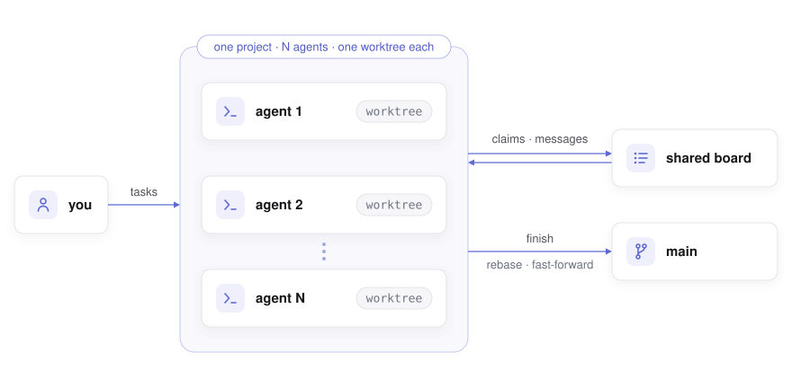

# chord

**Run coding agents as a cluster.**

<p align="center">
  <a href="LICENSE"></a>
  
  
  <a href="README-zh-CN.md"></a>
  <a href="https://www.bilibili.com/video/BV1Cns96REZ2/"></a>
</p>

One repository, as many agents as you care to start. Each agent works in its own worktree; a shared board records who holds which file; an agent that wants a file another agent holds asks first and waits for the answer; when the work is committed, one call rebases the branch and fast-forwards main. Idle agents are woken the moment a message arrives, so the agents negotiate among themselves while you keep handing out work in plain language.

<p align="center">
  <picture>
    <source media="(prefers-color-scheme: dark)" srcset="docs/demo-dark.svg">
    
  </picture>
</p>

## ✨ Highlights

- One repository, N agents, one worktree each: parallel work without stepping on each other
- A file-level claims board: register before editing, talk to the holder first, and a hook turns away any write that was never claimed
- Asynchronous messaging between agents: idle ones are woken, busy ones hear at their next tool call
- `finish` in one step: rebase, fast-forward main, release the claims, tell the others; on a conflict nothing changes and the agent is told to rebase, resolve it and finish again, asking you only if it cannot
- Agents learn the rules from chord itself, at start-up and on every prompt; you give tasks, not instructions about chord
- Agent-agnostic by design: adding a tool means one launch recipe, not a new coordinator
- `chord ls` for the whole picture, `messages` and `events` to replay what happened, `stop` and `clean` to wind down

## 📊 Benchmark

On [CooperBench](https://github.com/cooperbench/CooperBench) two agents each take one feature in the same repository, and a pair passes when the merged result passes the tests of both features.

| chord vs | gpt-6.1-sol | gpt-6-luna |
|---|---|---|
| solo (one agent, both features) | 76% vs 74% | 63% vs 51% |
| coop + git (messages and a shared git remote) | 76% vs 73% | 63% vs 47% |
| team (a lead hands out the work) | 76% vs 69% | **63% vs 34%** |
| coop (messages only) | 76% vs 11% | 63% vs 11% |

On the stronger model chord keeps pace with the best baselines. On the weaker one it is the only two-agent setup that does not fall below a single agent, and it beats the team setting by 20 points. chord's agents got only the feature text, while the coop + git and team prompts spell out how to split and merge the work.

## 🤖 Supported agents

| agent | status |
|---|---|
| Claude Code | supported |
| Codex CLI | supported |
| OpenCode | supported |
| Gemini CLI | planned |
| Cursor CLI | planned |
| GitHub Copilot CLI | planned |
| Qwen Code | planned |
| DeepSeek Harness | planned |

A new agent needs three things from its tool: a way to inject hooks and an MCP server at launch, the names and payloads of its hook events, and an idle/busy signal.

## 🧩 How it works

<p align="center">
  <picture>
    <source media="(prefers-color-scheme: dark)" srcset="docs/architecture-dark.svg">
    
  </picture>
</p>

1. **Isolation.** Every agent works on its own branch in its own worktree. The main checkout changes through `finish` alone.
2. **Coordination.** A shared board holds claims, messages and events. Agents register, claim and talk through tools chord gives them; hooks check claims before each write and hand new messages to the agent as it works.
3. **Merging.** `finish` rebases the branch onto main and fast-forwards. A clean rebase that passes the project's test command merges; on a conflict nothing moves, and the agent resolves it and finishes again.

## 📦 Install

With Node 24 and git on the machine:

```
npm install -g chord-cli
```

On Linux add `--allow-scripts=node-pty`, with python3, make and g++ present: node-pty ships no Linux binary and builds one on install. macOS needs nothing more: node-pty ships a binary for it.

Or from source:

```
git clone https://github.com/Cedr1cSun/chord-cli && cd chord-cli
npm install && npm link
```

## 🚀 Quick start

A project is a folder with the repository in a child directory:

```
my-project/
  my-repo/        the main checkout
  chord/          chord's own files, outside the repository
```

In the project folder, one terminal per agent:

```
chord claude                                     # start an agent
chord codex --name api                           # start another, named
chord opencode --name web                        # any mix of tools
chord claude "fix the flaky test in tests/auth"  # arguments after the tool name go to the tool
```

Hand out tasks in those terminals as you always would. From another terminal:

```
chord ls                 # agents, what they are on, unread messages, branch state, file claims
chord messages api       # what an agent has said and been told
chord events             # claims, releases, merges, conflicts
chord stop api           # let it finish its turn, then quit
chord clean              # remove the workspaces and branches of agents that have left
```

`--name` fixes an agent's name, workspace and branch, so launching the same name later returns to the same worktree. `chord resume <agent>` does that and also reopens the agent's own conversation, for Claude, Codex and OpenCode alike. Run chord in a repository root and it offers to move the repository into a child directory first.

Agents start in the project folder, the same directory you run plain `claude`, `codex` or `opencode` in, so that stays their project too: one `/resume` list, one CLAUDE.md, one trust answer. Each agent edits only its own worktree under `chord/agents/<name>/`; chord refuses edits (editor tools, apply_patch) to the main checkout and to other agents' worktrees, and tells the agent off after a shell command that ran there.

## 🧰 Commands

| command | what it does |
|---|---|
| `chord <agent> [--name x] [tool args...]` | start an agent: `claude`, `codex` or `opencode` |
| `chord resume <agent> [tool args...]` | start an agent that has left again, in its own worktree, reopening its own conversation |
| `chord ls [--all]` | agents and claims of this project, or of every project |
| `chord messages [agent] [-n N]` | message history |
| `chord events [agent] [-n N]` | claim, release, merge and conflict history |
| `chord stop <agent>` | quit an agent once its turn ends and its input box is empty |
| `chord clean [--force] [agent...]` | remove offline agents' workspaces, worktrees and branches; work not yet on main stays unless `--force` |
| `chord --version` | the installed version |

## ⚙️ Configuration

`<project>/chord/config.json`:

```json
{ "setup": "npm ci", "test": "npm test" }
```

`setup` runs once in every new worktree before the agent starts, with the `CHORD_*` variables in its environment, so a fresh worktree arrives with its dependencies in place. A failed setup abandons the launch and removes the worktree.

`test`, when set, runs in the agent's worktree each time `finish` has rebased the branch onto main, before main moves. If it fails nothing is merged and the agent gets the end of the output: a clean rebase can still break what another agent merged. Other agents' `finish` waits while it runs.

A repository's own Claude configuration (`.claude/settings*.json`, `.mcp.json`) reaches an agent once you have trusted that repository, or the project folder, in Claude Code yourself; the MCP servers you approved there are the ones that start.

## 🔌 How chord works with your tools

- **Waking an agent** means typing a short note into its terminal. chord does this only when the input box is empty, the keyboard has been quiet for a few seconds, and the terminal has echoed the note; a dialogue never receives the Enter.
- **Trust**: agents run in the project folder, so Claude asks about it once, as it does for plain `claude`; chord writes nothing to `~/.claude.json`. Codex asks you to review chord's hooks once, and again whenever their definition changes; answer "trust all". chord says so at launch if a hook has been switched off. OpenCode asks nothing: chord hands it the plugin and the MCP server through `OPENCODE_CONFIG_CONTENT`, so a configuration of your own set in that variable is not read while an agent runs; your global config, `OPENCODE_CONFIG_DIR` and the project's `opencode.json` are.
- **Branches and worktrees.** Each agent adds a `chord/<name>` branch and a worktree; `chord clean` removes them when the agent has left and keeps anything not yet on main.
- **Permissions.** chord's own tools are pre-approved for Claude, so an agent working on its own is never parked at a prompt for them; your usual shell and edit approvals apply as before. Codex keeps the sandbox and approval mode from your own configuration. On Windows chord refuses a sandbox given on the command line, because that sandbox cannot run the hooks; on Linux and macOS the hooks run inside the sandbox, but Codex then asks you to approve each chord tool call. OpenCode runs chord's tools without asking, as it does any MCP tool, and keeps your own permission rules for everything else.
- **The terminal title** reads `chord <agent> · <task>`, so each window says which agent it is.
- **Hooks gate the editor tools.** Files changed from the shell are reported by name after each command, with the claim to make.

## 🗺️ Scope

- Runs on Windows 11, macOS and Linux.
- One repository per project.
- Project paths up to about 190 characters.
- A repository with CRLF files and a `* text` attribute that was never renormalised shows phantom changes in every worktree; chord names the files and the command that puts the repository right.

## 🧪 Testing

`npm test` runs the unit tests against real git repositories in temporary folders. The coordination itself has been exercised end to end with the real tools, from two agents negotiating over one file to twenty agents merging into one main, and on open-source repositories in Python, Rust and JavaScript.

## 📄 Licence

[MIT](LICENSE)
